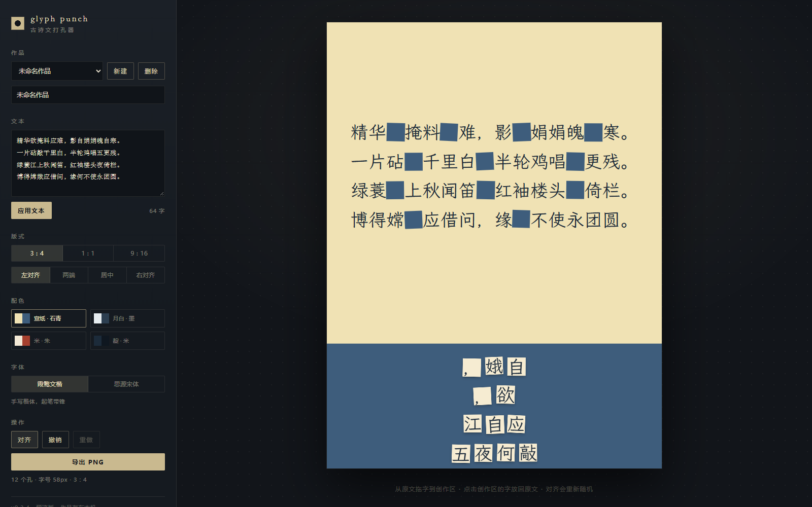

# glyph-punch

把古诗文打成孔。被挖下的字变成纸片，落在下方的创作区，你可以把它们重新拼成一句话。



## 这是什么

一个桌面端的**古诗文打孔器**。导入一段诗文，逐字点击打孔，字离开原位、变成一张纸片；纸片在创作区自由摆放，拖回原文区就回到原来的洞。作品按 3:4 / 1:1 / 9:16 画板导出为 PNG。

它不是背诵填空工具。约束来自原文（只能用被挖下的字），自由来自摆放——你是在用一首诗的字，写另一句话。

## 现在能做什么

- 粘贴文本，保留换行；字号自动适配，保证诗句不折行
- 单字点击打孔：纸片从洞口飞向创作区的随机落点，落点会避开已有纸片
- 或从原文直接把字拖到创作区，松手位置就是落点
- 每次取字都重新掷一次抖动（角度、偏移、尺寸），洞与纸片共用这一次的结果
- 纸片上的字与原文同字号，洞和纸片尺寸一致，抠下来的就是掉下去的那一块
- 点击创作区的纸片即可弹回原文，也可以拖回原文区回填
- 动效只回应动作：纸片落下有沉淀回弹、回填时沿直线飞回原洞、对齐与换比例时滑动归位、悬停微抬
- 尊重 `prefers-reduced-motion`，系统开启减弱动态时全部动效关闭
- 一键对齐：行识别 → 吸基线 → 行内均分 → 附加随机位移；纸片散落时改为按阅读顺序打包成行
- 画板 3:4 / 1:1 / 9:16，切换时纸片按比例重映射
- 四套双色主题；四种文本对齐
- 两套字体包：霞鹜文楷（默认）/ 思源宋体，可随时切换
- 多作品、自动保存到 localStorage、撤销/重做
- 1x PNG 导出，Canvas 独立渲染，所见即所得

## 开发

```bash
npm install
npm run dev        # http://localhost:5173
npm run build      # tsc --noEmit && vite build
npm run visual     # 用本机 Chrome 跑交互回归并截图（需先起 dev server）
```

技术栈：Vite + React + TypeScript，无运行时依赖之外的框架。纯静态，可直接部署到 GitHub Pages（`base: './'`）。

## 结构

```
src/
├── App.tsx        状态、作品管理、历史栈、工具栏
├── Artboard.tsx   画板：原文、洞、纸片、拖拽与回填判定
├── layout.ts      排版引擎：断行、字号自适应、对齐、纸片对齐算法
├── exportPng.ts   Canvas 导出（与 DOM 同一套坐标）
├── types.ts       数据模型、比例、主题
└── storage.ts     localStorage 持久化
docs/PRD.md        需求文档与决策记录
scripts/           无头浏览器视觉回归脚本
```

## 几个刻意的取舍

- **洞占位，文本不回流**：打孔不改变排版，相邻的孔通过抖动自然连成一条毛边。
- **纸片尺寸 = 原文字号**：纸片就是“从纸上抠下来的那一块”，所以字号只有一个来源。
- **对齐是显式动作**：拖动时不做磁吸，用户先自由摆，觉得乱了再点对齐；对齐结果带随机噪声，避免太工整。
- **孔洞抖动按作品 ID 定种子**：同一份作品刷新、导出永远一致，不会每次重画都变样。

## 已知限制

- 长文（如《赤壁赋》全文）会把字号压到十几像素，纸片随之变小、难以拖拽；后续会给创作区独立的字号或缩放。
- 字体包已内置两套，但每套都是完整 CJK 字集（霞鹜文楷约 18MB / 思源宋体约 6MB 的 woff2 分片），首屏只按需下载用到的子集，部署体积仍然偏大。
- 仅桌面端，手机端未适配。

## 路线

当前版本 **0.3.0**，按 0.x 迭代，接口与本地数据格式可能变动。

- **v0.3**：JSON 导出/导入、自定义配色入口、作品缩略图
- **v1.0**：交互与数据格式稳定
- **v2**：AI 挖字（给一段提示词，自动选出要挖的字）、分享链接

需求与决策的完整记录见 [docs/PRD.md](docs/PRD.md)。
